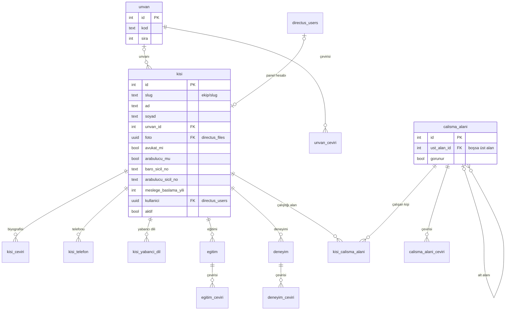
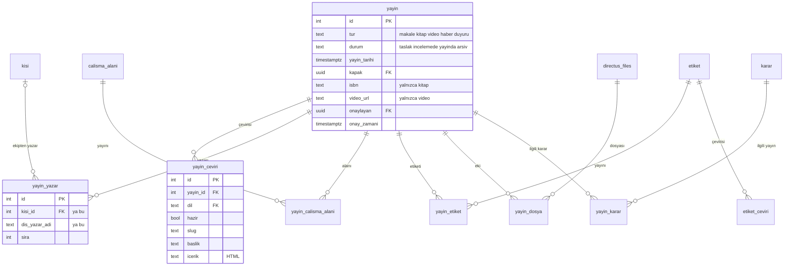
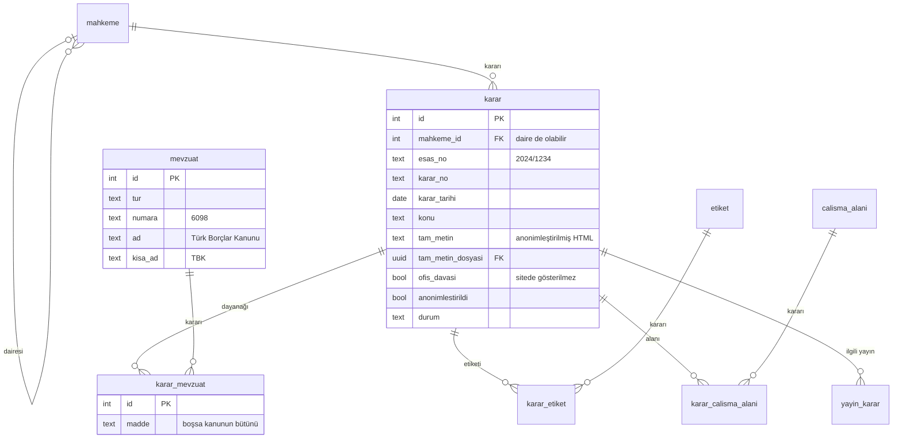
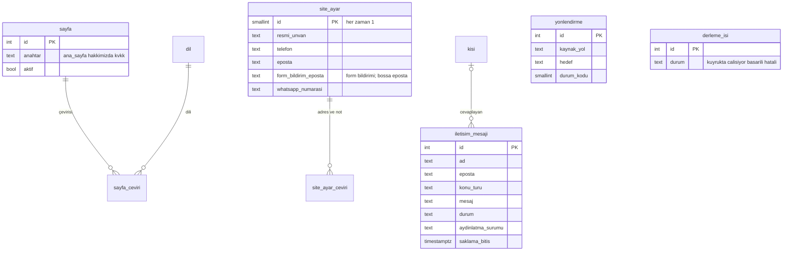

# Veri modeli — inceleme

Bu belge veritabanı tasarımını kontrol etmeniz için. Kodun kendisi [`schema.sql`](schema.sql); alan alan ayrıntı [`TABLOLAR.md`](TABLOLAR.md)'de.

| Dosya | İçerik |
|---|---|
| [`schema.sql`](schema.sql) | Çekirdek şema: 36 tablo |
| [`moduller/`](moduller/) | Opsiyonel modüller (12 tablo): sektör, bülten, kariyer, açılır duyuru, karar ekleri. İstenmeyen modül yüklenmez |
| [`ornek_veri.sql`](ornek_veri.sql) | Kurgusal örnek veri (kişiler uydurma, karar gerçek değil) |
| [`TABLOLAR.md`](TABLOLAR.md) | Her tablonun alanları, tipleri, zorunlulukları ve kuralları (veritabanından üretildi) |
| [`test/`](test/) | 18 test grubu (T00–T17); `db/test/calistir.sh` |

**Directus 12.5 ile denendi (11 Ekim 2026):**
- **Tanınma:** 48 tablonun hepsi koleksiyon olarak tanındı; 337 alan ve 84 ilişki var, tanınmayan alan tipi yok.
- **İç içe kayıt:** Yayın ve çevirileri tek istekte kaydedildi.
- **Kurallar:** "Türkçe çeviri olmadan yayına alınamaz" kuralı Directus üzerinden de çalışıyor.

Ayrıntı ve Directus'ta yapılması gerekenler §6'da.

---

## 1. Genel kurallar

Bunları bir kez okuyun; her tabloda aynı şekilde geçerli.

1. **Adlandırma:** Türkçe, yalnızca ASCII, `snake_case`, tekil (`kisi`, `yayin`, `karar`). Excel'deki adlar korundu.
2. **Kimlik:** Her tabloda otomatik artan `id` (sayı) var. İki istisna:
   - `dil` tablosunun anahtarı dil kodu (`tr`, `en`).
   - `site_ayar` tek satırlık bir tablo.
3. **Çok dillilik:** Her içerik iki tablodan oluşur: `X` ve `X_ceviri`.
   - Tarih, durum, dosya ve ilişkiler gibi dile bağlı olmayan alanlar `X`'te, metinler `X_ceviri`'de, her dil için bir satır.
   - **Yayındaki ya da sitede görünen kayıtların Türkçe çevirisi zorunlu.** Veritabanı bunu kayıt anında denetler. Kural şu tablolarda geçerli: yayın, çalışma alanı, sayfa, unvan, eğitim, deneyim, etiket ve site ayarları; modüllerde sektör, bülten sayısı, ilan ve açılır duyuru.
   - İngilizce isteğe bağlı. Site yalnızca Türkçe açılsa da yapı aynı kalır; İngilizce satır girilmez.
   - Kararlar yalnızca Türkçe; çeviri tablosu yok.
4. **Zengin metin:** Biyografi, makale içeriği ve sayfa içeriği HTML olarak saklanır. Directus'un editörü yazar, Astro siteyi üretirken temizler.
5. **Kullanıcılar ve dosyalar Directus'ta:**
   - Panel hesapları `directus_users` tablosunda. `olusturan`, `onaylayan` gibi alanlar buraya bağlanır; avukatın panel hesabı `kisi.kullanici` alanıyla bağlanır.
   - Görseller ve PDF'ler `directus_files` tablosunda. `foto`, `kapak` gibi alanlar buraya bağlanır.
   - Kendi kullanıcı, oturum, dosya ve değişiklik kaydı tablolarımız yok; Directus'unkiler kullanılır.
6. **Silme davranışı:**
   - Bir yayın ya da karar silinirse çevirileri ve bağları da silinir.
   - Bir kişi silinirse telefonu, yabancı dilleri, eğitimi, deneyimi ve çalışma alanı bağları da silinir. Ama yazarı olduğu bir yayın varsa kişi **silinemez**.
   - Çalışma alanı, etiket, mevzuat ve mahkeme kullanımdayken **silinemez**. Çalışma alanı `gorunur` = hayır ile gizlenir, mahkeme `aktif` = hayır ile pasif yapılır.
   - Bir dosya silinirse ona bağlı alan boş kalır; yayın eki bağlantısı silinir.
   - Ofisten ayrılan kişi silinmez, `aktif` = hayır yapılır.
7. **Yayın akışı:** `durum` alanı taslak → incelemede → yayında → arşiv sırasını izler.
   - "Yayında" için `yayin_tarihi` ve `onay_zamani` dolu olmalı.
   - İleri bir `yayin_tarihi` zamanlanmış yayın demek.
   - Kararlar için ek şart: `anonimlestirildi` işaretli olmalı.
8. **Türkçe sıralama:** Ad, soyad ve başlık gibi alanlar Türkçe alfabeye göre sıralanır (Ç, Ğ, İ, Ö, Ş, Ü doğru yerde). Bu davranış veritabanının hangi yerel ayarla kurulduğundan bağımsız.
9. **`ic` şeması:** Doğrulama fonksiyonları, çeviri kuralı tablosu ve KVKK temizlik fonksiyonu `ic` şemasında durur. Directus bunları görmez.

## 2. Diyagramlar

Okunabilirlik için yalnızca ilişkiler ve önemli alanlar gösteriliyor; tüm alanlar [`TABLOLAR.md`](TABLOLAR.md)'de.

### 2.1 Ekip ve çalışma alanları



### 2.2 Yayınlar



### 2.3 Kararlar



### 2.4 Sayfalar, ayarlar ve form



## 3. Excel'deki tablolardan farklar

| Excel tablosu | Excel durumu | Şemada | Değişiklik ve gerekçe |
|---|---|---|---|
| `kisi` | Kesin | `kisi` + `kisi_ceviri` | Eklenenler: slug, baro adı/sicil no, arabulucu sicil no, mesleğe başlama yılı, LinkedIn ve panel hesabı bağı. Biyografi çeviri tablosunda |
| `kisi_telefon` | Kesin | `kisi_telefon` | `sitede_goster` eklendi (cep varsayılan gizli) |
| `unvan` | Beklemede | `unvan` + `unvan_ceviri` | Sıralı. Örnek liste `ornek_veri.sql`'de |
| `egitim` | Kesin | `egitim` + `egitim_ceviri` | Başlangıç/bitiş yılı ve derece eklendi (ELIG örneği) |
| `deneyim` | Kesin | `deneyim` + `deneyim_ceviri` | Yıllar eklendi; firma adı düz metin |
| `firma` | Beklemede | **kaldırıldı** | Firma/müvekkil logosu reklam yasağı açısından riskli ("referanslar" yasağı) |
| `calisma_alani` | Kesin | `calisma_alani` + çeviri | İki seviye veritabanında zorunlu. Her alanın kendi sayfası için içerik ve SEO alanları var |
| `kisi_calisma_alani` | Kesin | aynı | — |
| `yayin` | Kesin | `yayin` + `yayin_ceviri` | Türe özgü alanlar yalnızca o türde dolabilir. `goruntulenme` kaldırıldı: statik sitede sayaç ayrı servis ve çerez/KVKK yükü demek |
| `yayin_yazar` | Kesin | aynı | Dış yazar unvanı ve sıra eklendi |
| `yayin_calisma_alani`, `etiket`, `yayin_etiket` | Kesin | aynı (+ `etiket_ceviri`) | — |
| `dosya` | Kesin | Directus'un `directus_files` tablosu | Yükleme, boyut ve görsel dönüştürme Directus'ta hazır |
| `yayin_dosya`, `yayin_karar` | Kesin | aynı | — |
| `karar` | Beklemede | `karar` (iskelet) | Alanlar büronun cevabına göre değişecek (§4). Yayına alma için anonimleştirme işareti şart |
| `mahkeme` | Beklemede | `mahkeme` | Mahkeme > daire, iki seviye; listeden seçilir |
| `mevzuat` | Beklemede | `mevzuat` + `karar_mevzuat` | Madde numarası bağda tutulur ("TBK m.344") |
| `sayfa` | Kesin | `sayfa` + `sayfa_ceviri` | — |
| `iletisim_mesaji` | Kesin | aynı | `kvkk_onay` yerine `aydinlatma_surumu` (aydınlatma rıza değildir, KVKK 2026/347). `saklama_bitis` ve otomatik silme eklendi |
| `kullanici` | Beklemede | Directus kullanıcıları + `kisi.kullanici` | Roller ve yetkiler Directus'ta tanımlanır |
| `site_ayar` | Kesin | `site_ayar` (tek satır) + çeviri | Anahtar-değer yerine adlı alanlar; Directus'ta düzgün bir form olarak görünür |
| `sektor` | Opsiyonel | `moduller/sektor.sql` | Küçük bir büro için önermiyorum |
| `ilan` | Opsiyonel | `moduller/kariyer.sql` | Başvuru e-postayla |
| `basvuru` | Opsiyonel | **yok** | CV toplamak saklama süresi, aydınlatma ve dosya silme yükü getirir |
| `odul` | Opsiyonel | **yok** | Ödül ve sıralama paylaşımı reklam yasağı riski taşıyor (TBB kararı 04.08.2025) |
| `duyuru` (pop-up) | Opsiyonel | `moduller/acilir_duyuru.sql` | Yalnızca nötr duyurular; sayfa içi şerit daha az riskli |
| `bulten_sayisi` | Opsiyonel | `moduller/bulten.sql` | — |

**Excel'de olmayan ama eklenenler:**
- **`dil`:** Diller tablosu.
- **`kisi_yabanci_dil`:** Kişinin bilinen yabancı dilleri. Yalnızca ISO kodu (`en`, `de`) saklanır; "İngilizce" / "English" adını site kendisi üretir, iki dilde elle yazmak gerekmez.
- **`yonlendirme`:** Adres değişince eski bağlantılar kırılmasın diye.
- **`derleme_isi`:** "Yayımla" kuyruğu.
- **`karar_etiket`, `karar_calisma_alani`:** Kararlarda filtre için.
- **`moduller/karar_ek.sql`:** Excel'in açık sorularındaki "hangi avukatın davası" ve "avukat yorumu" için `karar_kisi` ve `karar_yorum`.

## 4. Kontrol etmeniz gerekenler

### Büroya sorulacaklar (modeli değiştirir)

- [ ] **Dil:** Türkçe ve İngilizce mi, yalnız Türkçe mi? Yapı ikisinde de aynı; yalnızca panelde İngilizce sekmesinin görünüp görünmeyeceği değişir.
- [ ] **Unvanlar ve sırası:** Örnek liste şu: Kurucu Ortak, Ortak, Kıdemli Avukat, Avukat, Stajyer Avukat. "Kurucu ortak" gibi sıfatların sitede kullanımı baroya da sorulmalı.
- [ ] **Kararlar (Excel soru 29–36):**
  - Hangi alanlar girilecek? Şu an olanlar: mahkeme/daire, esas no, karar no, tarih, konu, özet, tam metin ve PDF.
  - Tam metin yazı olarak mı girilecek, dosya olarak mı? İkisi de var; biri kaldırılabilir.
  - Avukat yorumu olacak mı? (`karar_ek` modülü)
  - `ofis_davasi` alanı gerekli mi? Sitede gösterilmeyecek.
  - Anonimleştirmeyi kim yapacak?
  - Hangi alanlara göre filtrelenecek?
- [ ] **Yayın onayı:** Avukatın yazısı başka biri onaylamadan yayına çıkamasın mı? Model iki yolu da destekliyor; fark Directus yetkilerinde.
- [ ] **İletişim mesajlarının saklama süresi:** Şu an 1 yıl.
- [ ] **Sicil numaraları:** Baro ve arabulucu sicil numaraları sitede gösterilecek mi? Alanlar var.
- [ ] **Modüller:** Hangisi kalsın? Önerim:
  - Bülten: istenirse.
  - Kariyer: istenirse.
  - Karar ekleri: kararlar soruları cevaplanınca.
  - Sektör ve açılır duyuru: yok.

### Sizin bakmanız gerekenler

- [ ] **Ekip profili için eksik alan var mı?** Reklam yasağı yönetmeliğinin izin verdiği "mesleğe başlama tarihi" (`kisi.meslege_baslama_yili`) ve "bilinen yabancı dil" (`kisi_yabanci_dil`) eklendi. Sitede yalnızca yıl yazılmalı; "20 yıllık tecrübe" gibi öne çıkarma reklam sayılabilir. Akademik görevler ve mesleki üyelikler hâlâ yok; gerekli mi?
- [ ] **Çalışma alanlarında iki seviye yeterli mi?** Örnek: Kamu Hukuku > İmar Hukuku.
- [ ] **Yayın türleri yeterli mi?** Şu an: makale, kitap, video, haber, duyuru. Örneğin konuşma/seminer ya da röportaj ayrı bir tür olsun mu?
- [ ] **Mahkeme türleri listesi:** `mahkeme.tur` değerleri için [`TABLOLAR.md`](TABLOLAR.md#mahkeme)'ye bakın.
- [ ] **Site ayarlarında eksik bilgi var mı?** Örneğin faks, ikinci adres ya da çalışma saatleri.

## 5. Bu modelde bilerek olmayanlar

- **Müvekkil yorumları, müvekkil/firma logoları, ödüller:** Reklam yasağı (Yönetmelik m.7, "referanslar").
- **Görüntülenme sayacı:** Statik sitede ayrı bir servis ve çerez/KVKK yükü demek.
- **CV yükleme:** Kişisel veri; başvurular e-postayla alınır.
- **Kendi kullanıcı, oturum ve değişiklik kaydı tablolarımız:** Directus bunları sağlıyor.

## 6. Directus denemesinden çıkanlar

11 Ekim 2026'da Directus 12.5 kuruldu, bu şema, bütün modüller ve örnek veri yüklendi. API üzerinden şu durumlar denendi:

| Deneme | Sonuç |
|---|---|
| Tablolar koleksiyon olarak tanınıyor mu? | ✅ 48/48; tanınmayan alan tipi yok; 84 ilişki algılandı |
| Kimlikler | ✅ Sayı olarak dönüyor. Önce `bigint` denendi, metin olarak döndüğü için `integer` yapıldı |
| Türkçe sıralama | ✅ API'de `sort=soyad`: Demir, Kaya, Yılmaz |
| Yayın + Türkçe ve İngilizce çeviri tek istekte | ✅ Kabul |
| Yayın + yalnız İngilizce çeviri | ✅ Reddedildi |
| Yayındaki yazının Türkçe çevirisini silmek | ✅ Reddedildi; İngilizce çeviriyi silmek kabul |
| Hatalı e-posta, 3. seviye çalışma alanı | ✅ Reddedildi |
| Yabancı dil: kod yerine "Almanca", aynı dil iki kez; mesleğe başlama yılı 1940 | ✅ Reddedildi; aynı dil için anlaşılır mesaj |
| Tekil olmayan slug (yönetici olmayan editör) | ✅ Reddedildi; anlaşılır mesaj gösterildi |
| Kendi kuralımızı ihlal (yönetici olmayan editör) | ⚠️ Reddedildi, ama editör yalnızca "An unexpected error occurred." gördü |

**Directus kurulumunda yapılacaklar:**

1. **Çeviri alanları:** Her `X` için `ceviriler` adlı çeviri alanı ve ilişki ayarı gerekiyor.
   - İlişkide "seçim kaldırılınca sil" (`one_deselect_action: delete`) açık olmalı.
   - Bu açık değilse Directus çeviriyi silmek yerine bağını koparmaya çalışıyor ve hata veriyor (denendi).
2. **Hata mesajları:** Directus, yalnızca tekil değer, boş alan ve yabancı anahtar hatalarını editöre anlaşılır mesajla gösteriyor. Bizim kurallarımızın mesajını yalnızca yöneticiye gösteriyor.
   - Biçim kuralları (slug, e-posta, telefon, yıl) Directus alan doğrulamasına Türkçe mesajla girilmeli.
   - Kayıtlar arası kurallar için küçük bir Directus eklentisi yazılmalı: Türkçe çeviri, onay, anonimleştirme ve iki seviyeli ağaç.
   - Veritabanı kuralları yerinde kalır; bunlar son güvence.
3. **Otomatik alanlar:**
   - `olusturan` / `guncelleyen` Directus'un "user created / user updated" özel alanları olarak işaretlenmeli.
   - `onaylayan` ve `onay_zamani`, yayına alma sırasında bir akışla doldurulmalı.
   - `kisi_yabanci_dil.dil_kodu` açılır liste olmalı (İngilizce → `en`, Almanca → `de` …); editör kod yazmaz.
4. **İletişim mesajlarında değişiklik kaydı kapalı olmalı:** Açık kalırsa mesajın kopyası `directus_revisions` tablosunda kalır ve saklama süresi dolunca silinmez.
5. **Yetkiler:**
   - "Yazar" rolü yalnızca kendi kişi kaydını (`kisi.kullanici` = giriş yapan kullanıcı) ve kendi yayınlarını düzenler.
   - Bu rol `durum` alanını "yayında" yapamaz.
6. **Lisans:** Directus'un ücretsiz katmanı yalnızca **panelde yapılandırılmış** koleksiyonları sayıyor (en fazla 25) ve en fazla 3 kullanıcıya izin veriyor. Bu model yapılandırılınca 25'i geçecek; ücretsiz Open Innovation Grant anahtarı şart.

## 7. Kendi bilgisayarınızda denemek

```bash
# Testler (PostgreSQL 16 ile; root olmayan kullanıcı)
db/test/calistir.sh

# Directus ile
createdb insa
npx directus bootstrap                       # .env: DB_* ayarları bu veritabanını göstermeli
psql -X -v ON_ERROR_STOP=1 -d insa -f db/schema.sql -f db/moduller/bulten.sql -f db/ornek_veri.sql
npx directus start                           # http://localhost:8055

# Şema değişince alan listesini yeniden üretmek (şema + tüm modüller yüklü bir veritabanında)
PGDATABASE=insa python3 db/araclar/tablo_belgesi.py > db/TABLOLAR.md
```
